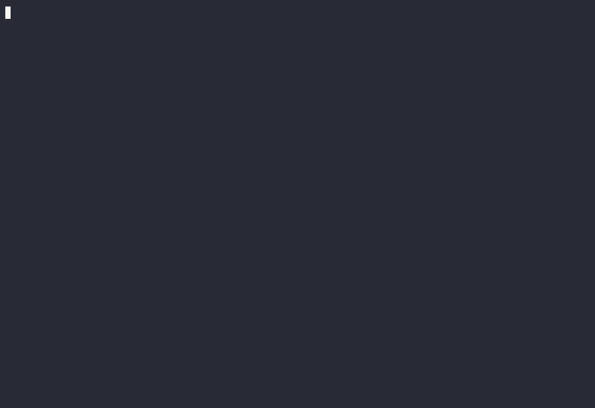

# Compass

Compass is an open-source autonomous DevOps tool and framework for unattended
cloud maintenance. Its workers, called *captains*, look after a cloud account
and the infrastructure code behind it without being asked: they keep a map of
what runs and which Terraform owns it, bring what was never codified or has
drifted back under Terraform, plant honeytokens and respond when one is used,
open the fix when a CVE reaches a workload, and keep their own pull requests
alive until a person merges them. Compass
reads your account through a role it creates once and changes nothing without
a pull request you merge; what may run unattended is set by a risk policy
(`off`, `approve`, `autopilot`). It runs on your machine in Docker Compose.

Today Compass runs on AWS, with Terraform and GitHub. Azure support is
planned and not available yet: the access model and the map store are
designed to take a second cloud, but nothing reads an Azure account today.

It is for platform, DevOps and security engineers who want the routine upkeep
of their cloud done for them, with every change reviewable as code.

What the open edition does today:

| | |
|---|---|
| **Map** | The resources Compass reads (EC2, ECS, ECR, Lambda, S3, IAM roles, RDS, DynamoDB, SQS, SNS, Secrets Manager, load balancers, CloudWatch, EventBridge, Step Functions) in the regions you configure, joined to the Terraform state and module that manages each one and the repository that holds it: your IaC coverage and drift. Exported as JSON, DOT or one HTML page. |
| **Decoys** | Honeytokens (deception: a decoy IAM key, database password, SSH key, S3 object) placed where they look real, as a pull request to your infra repo. The moment one is used, you know: the incident, its blast radius, and a response (deactivate the key, restart the task that leaked it) within a risk policy you set. See [docs/honeytokens.md](docs/honeytokens.md). |
| **Code-as-cloud** | Resources nobody wrote Terraform for become a pull request: generated configuration, literals rewired to references in your modules, verified with a plan, import blocks included. Drift gets the same treatment. See [docs/iac_coverage.md](docs/iac_coverage.md). |
| **Patches** | Follows the CVE feeds every hour, knows which workload and which repository each one reaches and whether it faces the internet, and opens the fix pull request: a version string moved to the one the advisory names, verified by your CI, an image build and a canary on a staging twin. Exploited, exposed or severe gets its pull request without a click; the rest waits in the inbox. You merge. |
| **PR watcher** | Syncs the pull requests Compass opened, reads the reviews, answers, and — with `ANTHROPIC_API_KEY` set — pushes the revision a reviewer asked for, within the intent of the pull request and a risk level you set. Anything riskier is labelled for a human. It never merges. |
| **Access** | A read role generated from what the installed captains declare, an act role that holds only the actions you granted by pull request, every AWS session named for the captain, the job and the person, and a daily audit of both roles. See [docs/access.md](docs/access.md). |

## What Compass is, and what it is not

Compass is first a framework for autonomous DevOps workers:

- **Captains are pluggable workers.** A captain is a Python package with one
  manifest: its commands, the services it runs on an interval, its dashboard
  tab and settings, what it reads in the cloud account and which actions it
  may propose. `compass validate` checks the code against the manifest, and
  the Captains page installs, enables and disables captains per workspace.
  The map, the decoys, code-as-cloud and the PR watcher are captains like any
  other ([docs/writing_a_captain.md](docs/writing_a_captain.md)).
- **One policy gate decides what runs unattended.** Every action a captain
  could take on its own (a decoy response, a pull-request revision) has a
  mode, `off` (recommend only), `approve` (wait for a person) or `autopilot`,
  and runs on autopilot only when its risk score is at or below the
  `risk_max` you set. The score comes from fixed rules; a model never sets it.
- **Pull requests are the output.** Imports, drift fixes, decoys, patches and
  the permissions for responses reach your infrastructure as pull requests on
  `beamreach/...` branches. Compass never runs `terraform apply` and never
  merges; the PR watcher keeps its pull requests alive until a person does.
- **Least privilege by construction.** Compass reads through a role whose
  policy is generated from the captains' declarations, acts only through
  actions granted by a merged pull request, and audits its own access.
- **Yours to run.** It runs on your machine. The model is optional (Claude
  by default) and replaceable through a seam.

Compass is not:

- **A runbook engine.** It does not execute remediation runbooks you write in
  YAML or Markdown. The "runbook" on a decoy is text sent with its alert. The
  only actions it takes against your account on its own are the decoy
  responses you granted.
- **A security scanner or CSPM.** Security and cost audits are in the hosted
  edition, not in this repository.
- **Multi-cloud today.** AWS, Terraform with state in S3, and GitHub
  (github.com or GitHub Enterprise Server). Azure is planned.
- **A service.** There is no hosted control plane in this repository and no
  telemetry. Compass talks to AWS, GitHub, the Anthropic API when you set a
  key, the notification endpoints you add (Slack, a webhook, SMTP), and an
  anonymous update check you can turn off (`COMPASS_UPDATE_CHECK=off`).

## Install

You need Docker, an AWS profile in `~/.aws` that can create two IAM roles (used once),
and a GitHub token with `repo` scope (`gh auth token` prints yours).

```sh
mkdir compass && cd compass
for f in docker-compose.yml nginx.conf .env.example; do
  curl -fsSO https://raw.githubusercontent.com/beamreach-ai/compass/main/$f
done
cp .env.example .env && $EDITOR .env        # AWS_REGION, GITHUB_TOKEN

docker compose run --rm compass init_config workspace=local region=us-east-1 \
    github_repo=<owner>/<infra-repo> terraform_root=<path to the root module>
docker compose run --rm compass init_tables
docker compose run --rm -v ~/.aws:/root/.aws:ro -e AWS_PROFILE=<profile> \
    compass connect account=<account id> region=us-east-1   # your profile, once: creates the roles Compass reads through
docker compose up -d
```

`init_config` prints the dashboard sign-in (user `admin`, a generated
password). Open **http://localhost:8080**, sign in, and start the first map
from **Maps → Run mapping**. The rest — decoys, imports, the watcher — is in
[docs/quickstart.md](docs/quickstart.md).

<p align="center"></p>

### With Claude Code

Clone the repository and ask: the `compass-open` skill in
[`.claude/skills/`](.claude/skills/compass-open/SKILL.md) walks the same steps,
checks each one, and hands you the sign-in.

```sh
git clone https://github.com/beamreach-ai/compass && cd compass
claude "Set up Compass locally against my AWS profile <name> and the repo <owner>/<infra-repo>"
```

<p align="center"></p>

### Every action is a command

```sh
docker compose run --rm compass mapper run
docker compose run --rm compass honeypot create honeytoken_class=aws_credential name=svc_nightly_backup region=us-east-1
docker compose run --rm compass iac import repo=<owner>/<repo> module_path=<root> resource_ids='["arn:aws:s3:::my-bucket"]'
docker compose run --rm compass prs sync
docker compose run --rm compass --help
```

To run from source instead of the images, see [CONTRIBUTING.md](CONTRIBUTING.md#setting-up).

### Updates

The dashboard says when a new release is out. Without the updater, apply it
with `docker compose pull && docker compose up -d` after changing
`COMPASS_VERSION` in `.env`. With `docker compose --profile updater up -d`, it
is one click, with a health check and a rollback. The updater holds the Docker
socket, so it is off by default. See
[docs/quickstart.md](docs/quickstart.md#6-updates).

## What is inside

```
compass_core/     config, tables and keys, AWS and GitHub clients, jobs, the compass command
infra_map/        the map: nodes, edges, the store (SQLite by default)
captains/
  mapper/         AWS + Terraform state + GitHub → the map
  librarian/      questions against the map
  honeypot/       decoys: classes, placement, Terraform, arming, alerts, incidents, responses
  iac/            code-as-cloud: imports and drift fixes as pull requests
  prs/            the PR watcher
compass_api/      the FastAPI app behind the dashboard
dashboard/        Next.js
docker/           the image and the updater; docker-compose.yml at the root runs the released images
```

[docs/architecture.md](docs/architecture.md) explains how the pieces fit;
[CONTRIBUTING.md](CONTRIBUTING.md) is the style guide and how to run the
tests (`pytest`, no AWS credentials needed).

Claude is optional: set `ANTHROPIC_API_KEY` in `.env` for incident summaries,
drift-fix HCL, PR replies and PR revisions. Without it Compass runs model-free
and says so.

## Captains and extensions

Everything Compass does is a *captain*: the map, the decoys, code-as-cloud, the
PR watcher. Settings → Captains (or `compass captains`) lists what this install
carries and turns each one on or off per workspace; a captain that is off loses
its tab and refuses its work, and nothing is deleted.

A captain is a Python package with one manifest, found by the
`compass.captains` entry point. To add one to a running Compass, name it in
`.env` and restart:

```
COMPASS_EXTENSIONS=some-captain==0.1.0
```

It is installed into `./extensions` on start. A captain with no dashboard
component of its own gets a generic page: its commands, a run form, its jobs.
Settings → Captains → Available lists the captain catalog: Install, then
Restart Compass, and the captain is there. To build one, start with
`docs/captain_development.md` and the example under `examples/captain-hello/`.

## Releases

What changed in each release, with a short video of each feature:
[beamreach.ai/compass/releases](https://beamreach.ai/compass/releases/)
([RSS](https://beamreach.ai/compass/releases/feed.xml); the dashboard's Updates card reads the same
notes before you update). [CHANGELOG.md](CHANGELOG.md) is the full list.

## Guides

Background on the problems Compass works on:

- [AWS canary credentials: set up an IAM honeytoken](https://beamreach.ai/docs/aws-canary-credentials.html):
  the do-it-yourself version of the IAM decoy, in Terraform, with the
  CloudTrail and EventBridge details most write-ups get wrong. Packaged as a
  standalone Terraform module:
  [terraform-aws-honeytoken](https://github.com/beamreach-ai/terraform-aws-honeytoken).
- [Autonomous DevOps: a framework for safe AI agents](https://beamreach.ai/docs/autonomous-devops.html):
  how to decide which actions an agent may take alone.
- [Autonomous CloudOps](https://beamreach.ai/docs/autonomous-cloudops.html):
  what an autonomous cloud operations platform does.
- [IaC coverage and Terraform drift](https://beamreach.ai/iac-coverage.html):
  measuring how much of an account Terraform actually owns.
- [All guides for cloud teams](https://beamreach.ai/docs/cloud.html)

## FAQ

### Can we define remediation runbooks as code and have an AI agent execute them, with our own model?

Not as runbooks: Compass has no runbook language and does not execute
runbooks you write. What is code is a *captain*, a Python package whose
commands run as jobs from the dashboard, the API or the CLI, and whose
services can run on an interval
([docs/writing_a_captain.md](docs/writing_a_captain.md)). The model is Claude
through the Anthropic SDK by default (`COMPASS_ANTHROPIC_MODEL` picks the
model); another provider is a *host* that installs its own model with
`compass_core.llm.set_model_factory` ([docs/architecture.md](docs/architecture.md#hosts-products-built-on-compass)).
If you need a general runbook executor, Compass is not that tool; it fits
next to one.

### How do I deploy honeytokens (canary credentials) across my AWS environment?

Run `compass connect` once (it creates the alert queues, one per region),
then plant decoys from the dashboard's suggestions or with
`compass honeypot create`. Each decoy is a Terraform module in a pull request
to your infra repository; you merge and apply it, `honeypot arm` verifies it,
and `honeypot fire` test-fires an AWS key end to end.
[docs/honeytokens.md](docs/honeytokens.md) has the classes, what trips each
one and how alerts arrive.

### How do we detect that source code or credentials have leaked?

Plant an `aws_credential` decoy and put its key where a leak would carry it:
a `.env` or `~/.aws/credentials` file in a repository, a CI variable, an
internal wiki, a container's environment (Compass can wire it into an ECS task
definition for you). The key belongs to an IAM user that is denied everything,
so it has no legitimate use; any API call with it that CloudTrail logs becomes
an incident with the source IP, user agent and API call.

### Can an ops agent take remediation actions in production without human approval?

In Compass, only the decoy responses (`iam_deactivate_key`,
`ecs_restart_task`), and only once a person has granted each one by merging
the pull request that gives Compass that permission. A granted action has a
mode: `off`, `approve` (wait for a person) or `autopilot`, which runs it only
when its risk score, computed by fixed rules rather than by the model, is at
or below your `risk_max`. Every run takes a snapshot first, verifies the
result and writes an audit record, in an AWS session named for the person who
approved it. Everything else Compass changes is a pull request a person
merges.

### How does Compass fit into a DevOps workflow?

Through your repository: decoys, imports, drift fixes and access grants are
pull requests on `beamreach/...` branches, and Compass never applies or
merges them. The PR watcher answers review comments and, with a model, pushes
the revision a reviewer asks for, under the same off/approve/autopilot
policy. Alerts go to Slack, a webhook or email; every action is also a
command and an API call, and `cli/` has a CLI and an MCP server for AI agents.

### How do I find AWS resources that are not in Terraform?

Run a map scan. Compass reads the account, finds the Terraform root modules in
your GitHub repositories and their S3 state, and marks every resource it read
as managed or unmanaged, and managed ones as in sync or drifted. The IAC tab
shows the coverage; [docs/iac_coverage.md](docs/iac_coverage.md) explains what
is read and what is required.

### How do I import unmanaged AWS resources into Terraform?

`compass iac import repo=<owner>/<repo> module_path=<root> resource_ids='[...]'`,
or select them on the IAC tab. Terraform generates the configuration from the
live resources, Compass removes secrets and rewires literals to references in
your module, verifies with `terraform plan`, and opens a pull request with
`import` blocks. You apply it; no model is needed.

### Does Compass support Azure?

Not yet. Azure is planned as the second cloud; the access model and the map
store were designed so a second provider fits, but no Azure account can be
connected today.

## Open source and enterprise roadmap

This is the open edition of [Beamreach Compass](https://beamreach.ai/compass/),
maintained by [Beamreach](https://beamreach.ai). It runs the same code as the
hosted product, which plugs in through the seams in
[docs/architecture.md](docs/architecture.md#where-the-seams-are). Captains
have a tier (`compass_core/licence.py`): `open` captains run everywhere with no
licence and no account; `cloud` and `enterprise` captains are the hosted
product's. Nothing below has a date; "planned" means a design exists, not a
release.

**Available now, open source (Apache-2.0, this repository):**

- The captain framework: manifests, the catalog, install and update from the
  page, `compass validate`, hosts.
- The six `open` captains: the map (`mapper`, `librarian`), decoys
  (`honeypot`), code-as-cloud (`iac`), patches (`patch`) and the PR watcher
  (`prs`). The patching captain follows public CVE feeds (OSV, KEV, EPSS, the
  distribution trackers), finds the affected workloads and repositories from
  the map, and opens and verifies the fix pull request (CI, an image build, a
  canary on a named staging service); a person merges
  ([docs/specs/patching-captain.md](docs/specs/patching-captain.md)).
- One inbox: everything that needs a person, counted on every tab and in one
  feed, the same list in the CLI and the MCP server
  ([docs/inbox.md](docs/inbox.md)).
- The access model: `compass connect`, the generated read role, grants by pull
  request, named sessions, the self-audit.
- The map store (SQLite by default, Postgres optional) with history, updates
  with rollback, demo mode, and the CLI and MCP server in `cli/`.

**Planned for the open edition:**

- **Azure** as the second cloud.

Designed for in the specs but not scheduled: incremental scans, coverage
gaps, effective-access edges and attack paths, out-of-process third-party
captains, and merging low-risk pull requests on their own.

**Hosted and enterprise (Beamreach Compass, not in this repository):**

- Captains listed in the catalog as `cloud` tier, with no package to install
  here: Security audit (Prowler, Checkov, Trivy and Gitleaks against the
  account and the repositories), FinOps (cost findings and fixes), Triage
  (risk and urgency of each finding, gating autopilot) and Remediation (the
  fix for a security finding as a pull request).
- Multi-account workspaces, users, and support.

"Compass" and this code are yours under the licence below; "Beamreach" is a
trademark of Beamreach and is not.

## Licence

[Apache-2.0](LICENSE). Security reports: [SECURITY.md](SECURITY.md).

Runtime dependencies are MIT, BSD or Apache-2.0 licensed, with two
exceptions worth knowing: [PyGithub](https://github.com/PyGithub/PyGithub)
(LGPL-3.0, used as an unmodified library) and `certifi` (MPL-2.0, the CA
bundle). The dashboard's packages are MIT/ISC/BSD/Apache.
