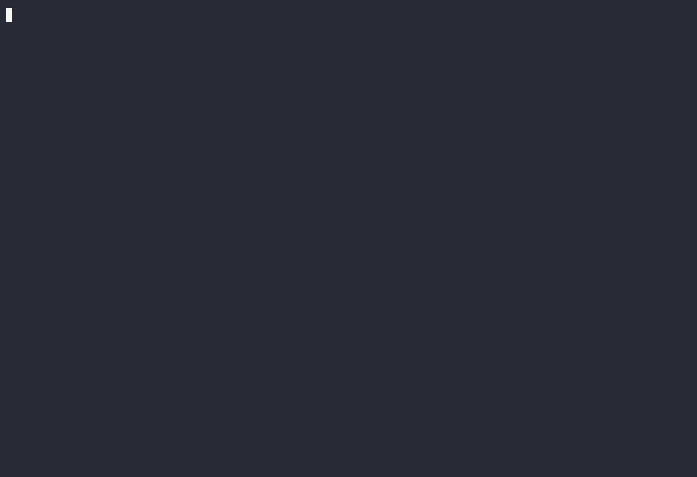

# Compass

Compass maps an AWS account to the Terraform and repositories that own it,
then acts on the map: plants decoy credentials that trip when used, imports
unmanaged resources into Terraform, and keeps the pull requests it opens
alive. It runs on your machine — a dashboard, an API, a daemon and a local
DynamoDB and a SQLite file in Docker Compose. Your credentials, your account;
nothing leaves.

| | |
|---|---|
| **Map** | Every resource in every region, joined to the Terraform state and module that manages it and the repository that holds it. Exported as JSON, DOT or one HTML page. |
| **Decoys** | Honeytokens — an IAM key, a database password, an SSH key, an S3 object, an API token, a DNS record — placed where they look real, as a pull request to your infra repo. The moment one is used, you know: the incident, its blast radius, and a response (deactivate the key, restart the task that leaked it) within a risk policy you set. |
| **Code-as-cloud** | Resources nobody wrote Terraform for become a pull request: generated configuration, literals rewired to references in your modules, verified with a plan, import blocks included. Drift gets the same treatment. |
| **PR watcher** | Syncs the pull requests Compass opened, reads the reviews, answers, and — with `ANTHROPIC_API_KEY` set — pushes the revision a reviewer asked for, within the files the pull request already touches and a risk level you set. Anything riskier is labelled for a human. |

## Install

You need Docker, an AWS profile in `~/.aws` that can create two IAM roles (used once),
and a GitHub token with `repo` scope (`gh auth token` prints yours).

```sh
mkdir compass && cd compass
for f in docker-compose.yml nginx.conf .env.example; do
  curl -fsSO https://raw.githubusercontent.com/beamreach-ai/compass/main/$f
done
cp .env.example .env && $EDITOR .env        # AWS_REGION, GITHUB_TOKEN

docker compose run --rm compass init_config workspace=local region=us-east-1 \
    github_repo=<owner>/<infra-repo> terraform_root=<path to the root module>
docker compose run --rm compass init_tables
docker compose run --rm -v ~/.aws:/root/.aws:ro -e AWS_PROFILE=<profile> \
    compass connect account=<account id> region=us-east-1   # your profile, once: creates the roles Compass reads through
docker compose up -d
```

`init_config` prints the dashboard sign-in (user `admin`, a generated
password). Open **http://localhost:8080**, sign in, and start the first map
from **Maps → Run mapping**. The rest — decoys, imports, the watcher — is in
[docs/quickstart.md](docs/quickstart.md).

<p align="center"></p>

### With Claude Code

Clone the repository and ask: the `compass-open` skill in
[`.claude/skills/`](.claude/skills/compass-open/SKILL.md) walks the same steps,
checks each one, and hands you the sign-in.

```sh
git clone https://github.com/beamreach-ai/compass && cd compass
claude "Set up Compass locally against my AWS profile <name> and the repo <owner>/<infra-repo>"
```

<p align="center"></p>

### Every action is a command

```sh
docker compose run --rm compass mapper run
docker compose run --rm compass honeypot create honeytoken_class=aws_credential name=svc_nightly_backup region=us-east-1
docker compose run --rm compass iac import repo=<owner>/<repo> module_path=<root> resource_ids='["arn:aws:s3:::my-bucket"]'
docker compose run --rm compass prs sync
docker compose run --rm compass --help
```

To run from source instead of the images, see [CONTRIBUTING.md](CONTRIBUTING.md#setting-up).

### Updates

The dashboard says when a new release is out. Without the updater, apply it
with `docker compose pull && docker compose up -d` after changing
`COMPASS_VERSION` in `.env`. With `docker compose --profile updater up -d`, it
is one click, with a health check and a rollback. The updater holds the Docker
socket, so it is off by default. See
[docs/quickstart.md](docs/quickstart.md#6-updates).

## What is inside

```
compass_core/     config, tables and keys, AWS and GitHub clients, jobs, the compass command
infra_map/        the map: nodes, edges, the store (SQLite by default)
captains/
  mapper/         AWS + Terraform state + GitHub → the map
  librarian/      questions against the map
  honeypot/       decoys: classes, placement, Terraform, arming, alerts, incidents, responses
  iac/            code-as-cloud: imports and drift fixes as pull requests
  prs/            the PR watcher
compass_api/      the FastAPI app behind the dashboard
dashboard/        Next.js
docker/           the image and the updater; docker-compose.yml at the root runs the released images
```

[docs/architecture.md](docs/architecture.md) explains how the pieces fit;
[CONTRIBUTING.md](CONTRIBUTING.md) is the style guide and how to run the
tests (`pytest`, no AWS credentials needed).

Claude is optional: set `ANTHROPIC_API_KEY` in `.env` for incident summaries,
drift-fix HCL, PR replies and PR revisions. Without it Compass runs model-free
and says so.

## Captains and extensions

Everything Compass does is a *captain*: the map, the decoys, code-as-cloud, the
PR watcher. Settings → Captains (or `compass captains`) lists what this install
carries and turns each one on or off per workspace; a captain that is off loses
its tab and refuses its work, and nothing is deleted.

A captain is a Python package with one manifest, found by the
`compass.captains` entry point. To add one to a running Compass, name it in
`.env` and restart:

```
COMPASS_EXTENSIONS=some-captain==0.1.0
```

It is installed into `./extensions` on start. A captain with no dashboard
component of its own gets a generic page: its commands, a run form, its jobs.
Settings → Captains → Available lists the captain catalog: Install, then
Restart Compass, and the captain is there. To build one, start with
`docs/captain_development.md` and the example under `examples/captain-hello/`.

## Compass and Beamreach

This is the open edition of [Beamreach Compass](https://beamreach.ai/compass/),
maintained by [Beamreach](https://beamreach.ai). The hosted product adds
security and cost audits with automated fixes, multi-account workspaces and
support; it runs this same code underneath. "Compass" and this code are
yours under the licence below; "Beamreach" is a trademark of Beamreach and
is not.

## Licence

[Apache-2.0](LICENSE). Security reports: [SECURITY.md](SECURITY.md).

Runtime dependencies are MIT, BSD or Apache-2.0 licensed, with two
exceptions worth knowing: [PyGithub](https://github.com/PyGithub/PyGithub)
(LGPL-3.0, used as an unmodified library) and `certifi` (MPL-2.0, the CA
bundle). The dashboard's packages are MIT/ISC/BSD/Apache.
